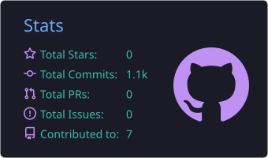
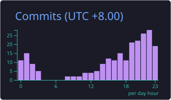
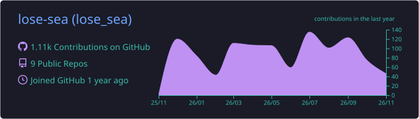
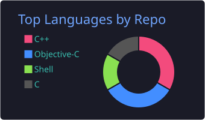
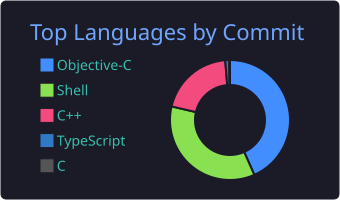

<h1 align="center">Hi, I'm lose_sea 👋</h1>

  <strong>iOS &amp; C/C++ Developer</strong> · Objective-C / C / C++

<!-- 如需添加头图，可取消下方注释并替换为自己的图片链接 -->
<!-- 

 -->

  
  <!-- 按需取消注释并替换成你的个人链接 -->
  <!--  -->
  <!--  -->
  <!--  -->

---

## Tech Stack

  
  
  
  
  
  
  

## GitHub Snapshot

  
  

## GitHub Summary

  

  
  

## Contribution Snake

  <picture>
    <source media="(prefers-color-scheme: dark)" srcset="https://raw.githubusercontent.com/lose-sea/lose-sea/output/github-contribution-grid-snake-dark.svg" />
    <source media="(prefers-color-scheme: light)" srcset="https://raw.githubusercontent.com/lose-sea/lose-sea/output/github-contribution-grid-snake.svg" />
    
  </picture>

---

  Keep building. Keep learning.

